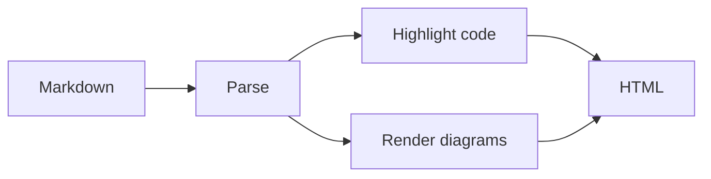
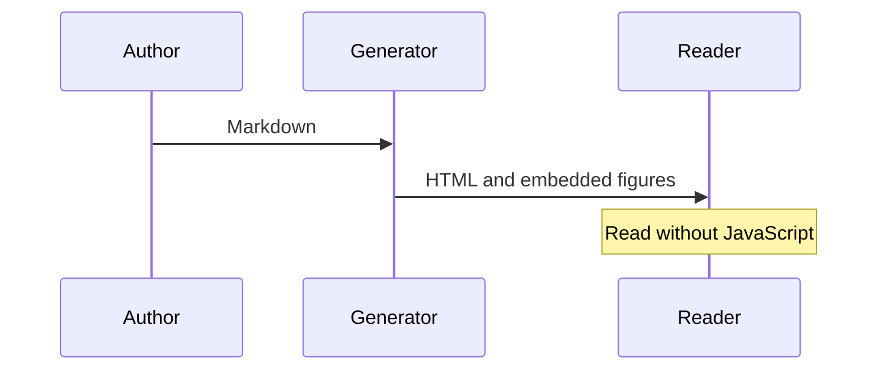

# Catalog evidence

The catalog contains **844 statements** and **978 findings**.[^catalog]

## Read the evidence

> [!IMPORTANT]
> Only **35 of 844 statements** were resolved. Findings do not imply complete coverage.
>
> - Keep the unresolved statements visible.
> - Inspect the source before drawing a conclusion.

Coverage
: The share of statements whose references could be resolved.

```sql
-- Keep the original statement visible.
SELECT post_title FROM wp_posts WHERE post_status = 'publish';
```

The resolved share is $35 / 844$. The calculation is:

$$
\mathrm{coverage} = \frac{35}{844} \times 100\%
$$

## Follow the process





[^catalog]: WordPress SQL catalog: 844 statements, 978 findings, 35 resolved statements.
